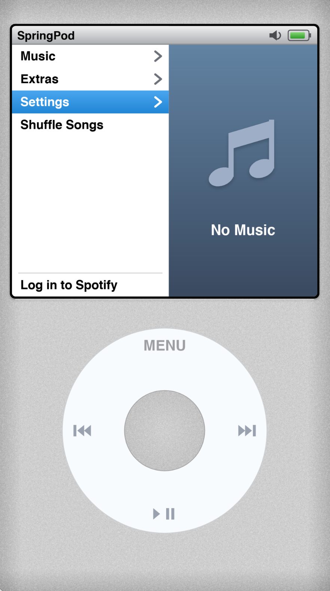
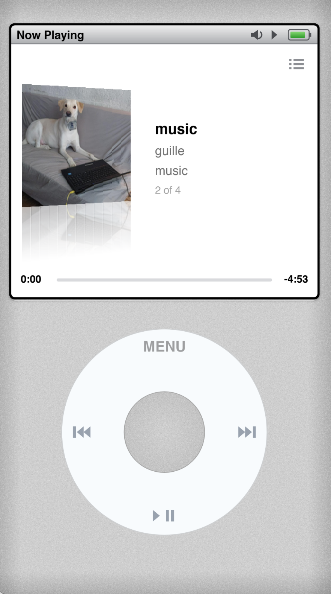
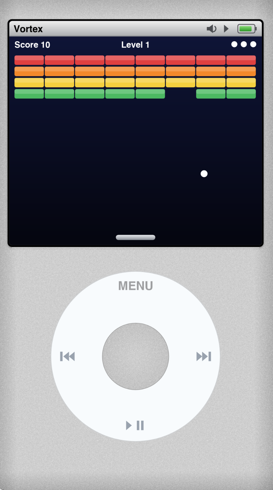

#  SpringPod for Android 

⠀

---

##  About SpringPod

**SpringPod for Android** is a lightweight recreation of the **Apple iPod**. 

---

##  Features

- **UI Recreation:** UI elements built STRAIGHT from real iPod (6th Generation) Firmware.
- **Audio Playback:** Background playback, Volume control, and play/pause controls.
- **Spotify Playlists:** Connect your Spotify account and listen to your saved songs and playlists!
- **Import Audio:** Import your own music with working metadata!

---

## Photos

  
  
  

---

## Installation

### Device Requirements

- **Android Version:** Android 5.0 (Lollipop) or above. (Target is Android 11 - API 30)
- **Memory:** 1GB (2GB for cleaner experience)
### Installation & Setup

1. **Download the .APK File from MediaFire**
   ### [MediaFire Download](https://www.mediafire.com/file/6ywulnayn5nqkxs/SpringPod.apk/file)
2. **Run the .APK file**
 >accept any warnings that are presented, the code is open source. If you feel as if you need to you can look through the code to make sure there is nothing malicious.
3. **Add your songs** and enjoy SpringPod!
